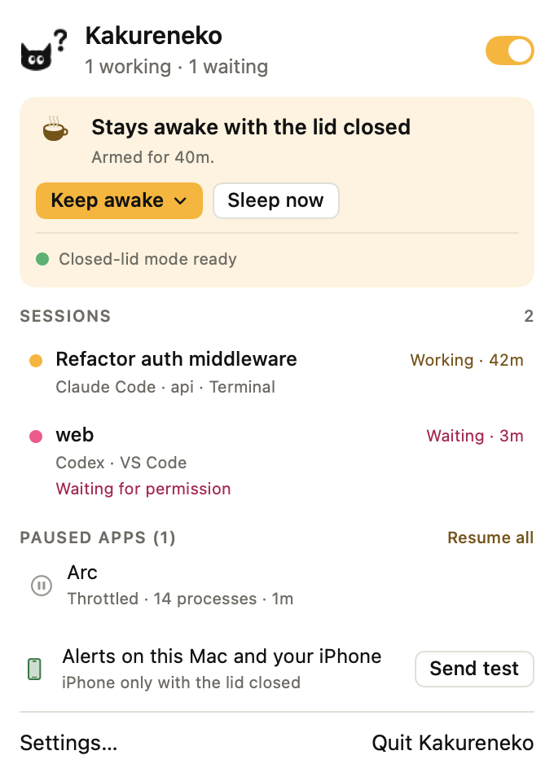
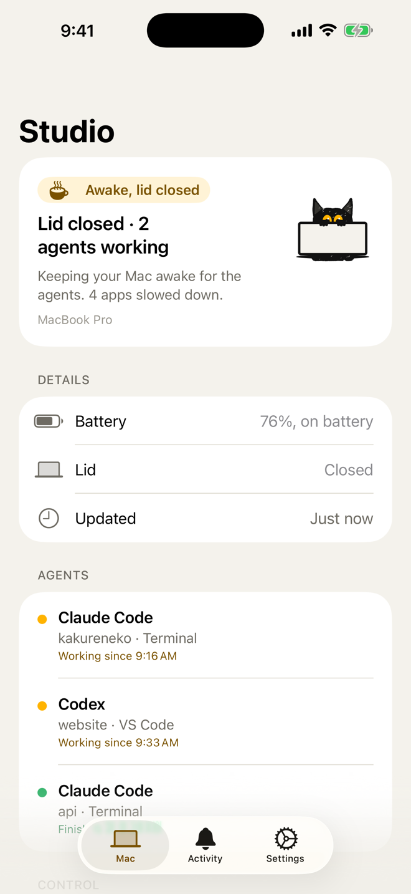

# Kakureneko

A menu bar app that keeps a MacBook awake while AI coding agents (Claude Code, Codex and other command-line agents)
work, even with the lid closed, and lets it sleep when they're done. A companion iPhone app shows what the Mac is
doing and gets its alerts through your own iCloud: no account, no server, no pairing.

Kakureneko (隠れ猫) is Japanese for "hiding cat", like Soot, our cat, who keeps watch behind the closed lid.

<p>
  
  
</p>

Kakureneko is no longer in active development. The Mac app and the iPhone beta stay available as they are, for free.

## Mac

**[Download Kakureneko.dmg](https://github.com/y0ung-T/kakureneko/releases/latest/download/Kakureneko.dmg)**
(all versions: [Releases](https://github.com/y0ung-T/kakureneko/releases)). Needs macOS 26 or later, on Apple
silicon or Intel.

1. Open the disk image and drag **Kakureneko** into **Applications**.
2. Open Kakureneko from Applications. The app is signed and notarized; macOS asks once whether to open an app
   downloaded from the internet. Choose **Open**.
3. Kakureneko lives in the menu bar as a small cat's head, with no Dock icon. The setup window opens the first time.

Updates arrive inside the app (Settings → General → Check for Updates…).

### First-run setup

The setup has four steps. You can skip any of them and open it again from Settings → General → Show Setup Again….

1. **Closed lid.** Install closed-lid mode with one administrator prompt, or choose *Skip · notifications only*.
2. **Alerts.** Allow notifications on the Mac. Choose *Set up my iPhone* to get alerts there too, or *Just this Mac*
   to keep them on the Mac (nothing goes to iCloud).
3. **Agents.** Kakureneko lists the coding agents it finds and shows the exact change it would make to each agent's
   settings. Nothing is written until you confirm, and the original is backed up to `~/.kakureneko/backups` first.
4. **When done.** What happens when every agent is done: *Sleep* (recommended) or *Shut down*.

### Closed-lid mode

A MacBook sleeps as soon as you close the lid. Keeping it awake takes one system setting that only an administrator
can change, so Kakureneko asks once, during setup, and installs two small pieces:

- **A sleep rule** in `/private/etc/sudoers.d/kakureneko`. It lets your user run exactly two commands without a
  password, and nothing else: `/usr/bin/pmset -a disablesleep 1` and `/usr/bin/pmset -a disablesleep 0`.
- **A fail-safe**: a small system service (`com.kakureneko.failsafe`) that runs
  `/Library/Application Support/Kakureneko/kakureneko-failsafe.sh` at startup and every minute. It turns sleep back
  on if Kakureneko stops for about 3 minutes, or when the battery reaches 7 %.

Without closed-lid mode, Kakureneko only sends alerts, and closing the lid sleeps the Mac as usual. Settings → Closed
Lid & Safety shows it and can remove it on its own.

### Safety stops

With the lid closed, Kakureneko lets the Mac sleep, and sends an alert that says why, when:

- the battery drops to 20 % (you can choose 10–50 %), or has less than about 25 minutes left;
- the Mac runs hot for a minute;
- the network has been gone for 15 minutes;
- the lid has been closed for 12 hours (you can choose 1–24).

On battery, it plays a sound when you close the lid while an agent is working: a reminder not to put a running Mac
in a bag.

## iPhone

Kakureneko for iPhone is a **TestFlight beta** for friends. It needs iOS 18 or later. Ask
[y0ung-T](https://github.com/y0ung-T) for an invite, install TestFlight from the App Store, and open the invite on
your iPhone.

The app gets the same alerts as the Mac, shows what the Mac is doing, and has Keep awake and Sleep now buttons.

1. Use the **same Apple Account** on the iPhone and the Mac, with **iCloud on**.
2. Open the app and **allow notifications**. Turn on Time Sensitive alerts too, so "an agent needs you" gets through
   Focus.
3. On the Mac, choose *Set up my iPhone* during setup, or turn on *Send alerts to your iPhone* in Settings →
   Notifications. *Send them* sets when: *Only when the lid is closed* (the default), *When I'm away from the Mac*,
   or *Always*.

To check the connection, tap *Send Test Alert* in the app's Settings tab.

## Problems

- **No alerts on the iPhone.** By default they only go to the iPhone while the lid is closed. Check that both devices
  use the same Apple Account with iCloud on, and that notifications are allowed for Kakureneko on the iPhone. If a
  test alert arrives, the connection works and the timing setting is holding alerts back.
- **The Mac went to sleep anyway.** Closed-lid mode may not be installed, no agent was working (check Settings →
  Agents for each agent's hook), a safety stop fired (you got an alert saying which), or the countdown ran out: by
  default 5 minutes after the last agent finished, or 10 after one started waiting for you.
- **Other apps are slow while the lid is closed.** That's on purpose: Kakureneko slows down apps the agents don't
  need, so the battery lasts. Add an app under Settings → Pausing Apps → Never pause, or turn pausing off there.
- **Logs** are in `~/.kakureneko/log`. They record what Kakureneko did, not your prompts or the agents' messages.

Found a bug? [Open an issue](https://github.com/y0ung-T/kakureneko/issues) with your Mac model, macOS version and
Kakureneko's version (Settings → General → About Kakureneko), and attach the logs if you can.

## Uninstall

Open Settings → General → **Uninstall Kakureneko…**. It removes closed-lid mode (it asks for your password), the hooks
in your agents' settings, opening at login, its settings and logs, and finally the app itself. Dragging the app to the
Trash isn't enough: it leaves closed-lid mode and the agent hooks behind.

If you can't open the app, remove closed-lid mode in Terminal (the same commands Kakureneko runs):

```sh
sudo /usr/bin/pmset -a disablesleep 0
sudo /bin/launchctl bootout system/com.kakureneko.failsafe
sudo /bin/rm -f /Library/LaunchDaemons/com.kakureneko.failsafe.plist /private/etc/sudoers.d/kakureneko
sudo /bin/rm -rf "/Library/Application Support/Kakureneko"
```

Then remove the entries that mention `kakureneko-hook` from your agents' settings (originals are in
`~/.kakureneko/backups`), and only after that delete `~/.kakureneko` and `~/Library/Application Support/Kakureneko`.

## Privacy

No analytics, no tracking, no ads. Alerts and the Mac's status travel through Apple's iCloud and are deleted after a
few days. The details are in [PRIVACY.md](PRIVACY.md).

## Building from source

The Mac app is a Swift package (`Package.swift`); the iPhone app is generated with XcodeGen from `Xcode/project.yml`.
`scripts/install.sh` builds the Mac app and installs it into `~/Applications`, and `scripts/build-phone.sh` builds the
iPhone app. Both are signed for team 7NRW73MYQZ and its iCloud container, so a build for your own team needs your own
bundle identifiers and container. [docs/ARCHITECTURE.md](docs/ARCHITECTURE.md) explains how it works and
[docs/RELEASE.md](docs/RELEASE.md) how releases are made.

© 2026 y0ung-T
